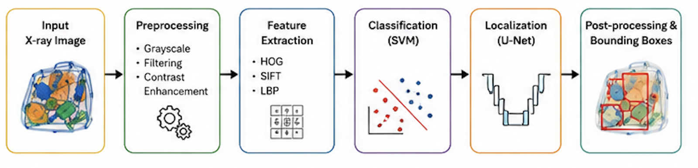
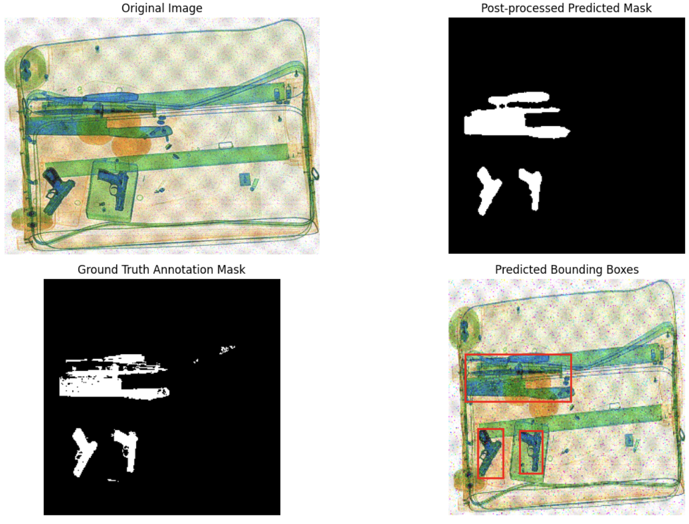

# 🧳 Baggage Threat Detection & Localization

> Finding guns, knives, and shurikens in cluttered X-ray baggage images with a binary U-Net and classical computer vision.


[Open in Colab](https://colab.research.google.com/github/yasminemagdy/baggage-threat-localization/blob/main/notebooks/unet_localization_colab.ipynb) · 

## Description

A computer-vision pipeline for X-ray baggage screening, built for **CEN454 at Abu Dhabi University**. It combines noise removal, enhancement, segmentation, localization, and classification for noisy, cluttered baggage images.

Classical segmentation (Otsu, edge detection, morphology) failed on overlapping objects and busy backgrounds, so localization uses a **binary U-Net** that answers one question: *"Where is the threat?"* Predicted masks are cleaned with morphological post-processing, and **bounding boxes come from connected components**. Classification is handled separately with classical ML (HOG / SIFT / LBP + SVM).



## Key Features

- Binary U-Net localizer (sigmoid output, threshold 0.5)
- Lightweight preprocessing: grayscale, 256×256 resize, 3×3 Gaussian blur, [0,1] normalization
- Dice + BCE loss to handle background/foreground imbalance
- Augmentation: horizontal flip, rotation (±20°), brightness/contrast jitter
- Post-processing: opening, closing, connected-component filtering (area and aspect-ratio checks)
- Multi-object bounding boxes from connected components
- Dice / IoU evaluation (pixel accuracy is misleading when the background dominates)
- Batch inference: saves predicted masks for a folder of test images

## Screenshot



*Original image, post-processed predicted mask, ground-truth mask, and predicted bounding boxes.*

## Results

| Test image | Dice | IoU |
|---|---|---|
| knife/P00043.png | 0.935 | 0.878 |
| gun/P00096.png | 0.864 | 0.760 |
| shuriken/B0048_0166.png | 0.720 | 0.563 |
| knife/P00184.png | 0.901 | 0.821 |

Scores are highest on clear scenes and drop with clutter and occlusion (see `docs/images/result_failure.png`).

## Repository Structure

```
.
├── notebooks/unet_localization_colab.ipynb   # train, evaluate, predict (PyTorch)
├── matlab/                                   # MATLAB preprocessing / training scripts
├── docs/                                     # report PDF + figures
├── data/                                     # dataset goes here (not tracked)
├── models/                                   # trained weights (not tracked)
├── requirements.txt
└── LICENSE
```

## Install & Run (≈5 minutes)

### Option A: Google Colab (recommended)

1. Click **Open in Colab** above.
2. **Runtime → Change runtime type → GPU**.
3. Zip your dataset (layout below) and upload it to Google Drive.
4. In the notebook, update the Drive paths (dataset zip, weights, test folder).
5. **Runtime → Run all**. The best weights are saved to your Drive.

### Option B: Local

```bash
git clone https://github.com/yasminemagdy/baggage-threat-localization.git
cd baggage-threat-localization
python -m venv venv
source venv/bin/activate          # Windows: venv\Scripts\activate
pip install -r requirements.txt
jupyter notebook notebooks/unet_localization_colab.ipynb
```

Skip the `google.colab` / Drive cells and point the path variables at your local `data/` folder. A GPU is strongly recommended; CPU training is slow.

### Dataset layout

```
dataset/
├── gun/  knife/  shuriken/  safe/
└── annotations/
    └── gun/  knife/  shuriken/      # masks share the image's base filename
```

See [`data/README.md`](data/README.md). The dataset is not included.

## Usage

- **Train:** run the training cell (30 epochs, Adam, lr 1e-4, batch 8). The best model by mean IoU is saved automatically.
- **Evaluate one image:** set `img_path` / `gt_path` in the evaluation cell to get IoU, Dice, and a 4-panel visualization.
- **Batch predict:** put images in the test folder and run the last cell. Masks are saved as `<name>_mask.png`.

## Tech Stack

- **Languages:** Python, MATLAB
- **Deep learning:** PyTorch (custom U-Net)
- **Image processing:** OpenCV, NumPy
- **Visualization / tooling:** Matplotlib, tqdm, Jupyter
- **Classical ML (classification):** HOG / SIFT / LBP features + SVM
- **Environment:** Google Colab (GPU)

## Limitations & Future Work

- Dark non-threat regions can appear as false blobs, so safe images should be added as true negatives.
- Some ground-truth masks do not match their images, so the annotations need an audit.
- Planned: multiclass segmentation with clean per-class masks, U-Net++, and an O-Net-inspired dual-input model.


*AI disclosure:* ChatGPT was used for brainstorming and debugging support; all suggestions were tested and validated.

## License

[MIT](LICENSE). The dataset is subject to its own license.
